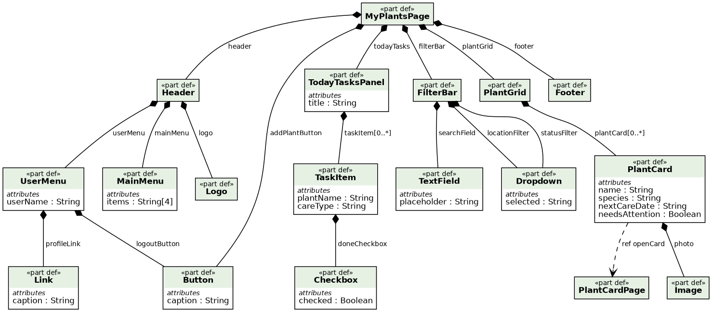
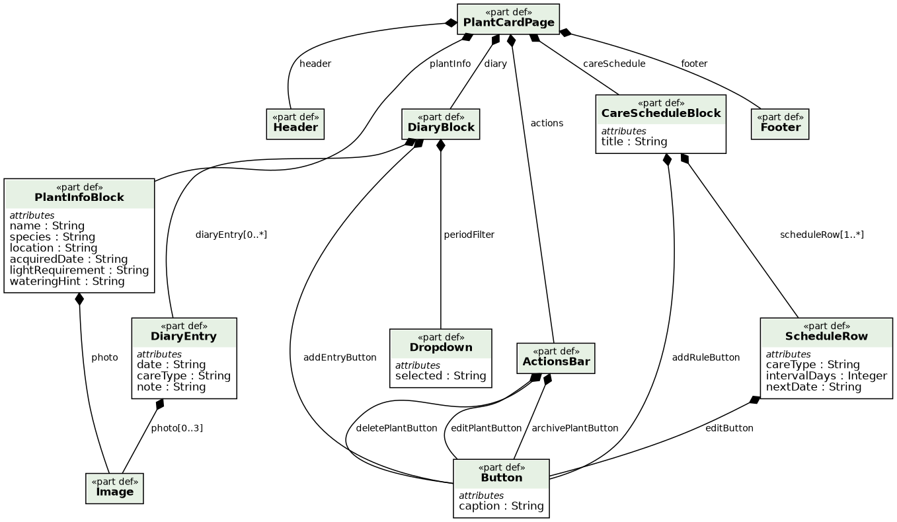
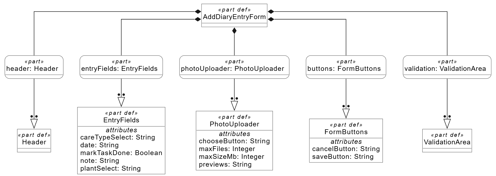
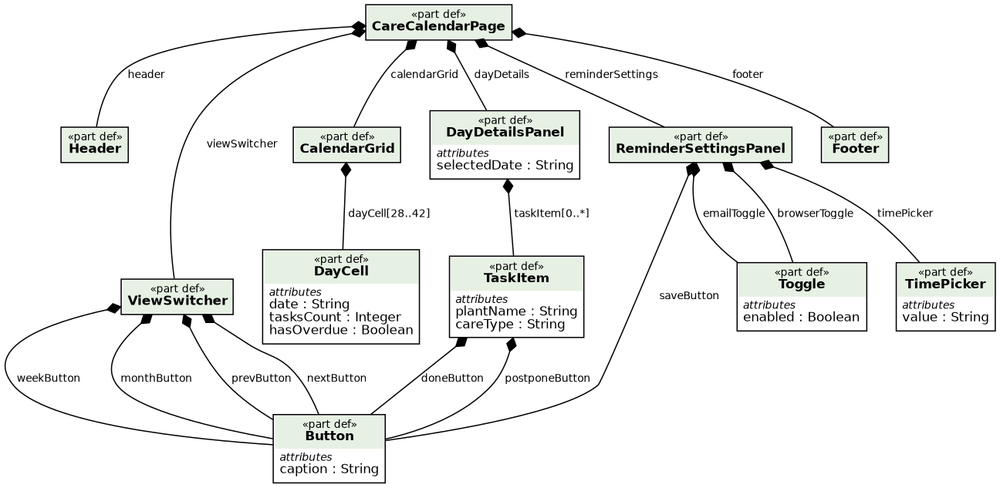

# Спецификация требований к ПО

Для веб-приложения "LeafLog" — дневник ухода за растениями

Версия 0.2

Подготовил Бухвал П.Д.

БГУИР, ФКСиС, кафедра ЭВМ

22.10.2026

## Оглавление

<!-- TOC -->
* [1. Введение](#1-introduction)
  * [1.1 Назначение документа](#11-document-purpose)
  * [1.2 Область применения продукта](#12-product-scope)
  * [1.3 Определения, акронимы и сокращения](#13-definitions-acronyms-and-abbreviations)
  * [1.4 Ссылки](#14-references)
  * [1.5 Обзор документа](#15-document-overview)
* [2. Обзор продукта](#2-product-overview)
  * [2.1 Перспектива продукта](#21-product-perspective)
  * [2.2 Функции продукта](#22-product-functions)
  * [2.3 Ограничения продукта](#23-product-constraints)
  * [2.4 Характеристики пользователей](#24-user-characteristics)
  * [2.5 Допущения и зависимости](#25-assumptions-and-dependencies)
  * [2.6 Распределение требований](#26-apportioning-of-requirements)
* [3. Требования](#3-requirements)
  * [3.1 Внешние интерфейсы](#31-external-interfaces)
    * [3.1.1 Пользовательские интерфейсы](#311-user-interfaces)
    * [3.1.2 Аппаратные интерфейсы](#312-hardware-interfaces)
    * [3.1.3 Программные интерфейсы](#313-software-interfaces)
  * [3.2 Функциональные требования](#32-functional)
  * [3.3 Качество обслуживания](#33-quality-of-service)
    * [3.3.1 Производительность](#331-performance)
    * [3.3.2 Безопасность](#332-security)
    * [3.3.3 Надёжность](#333-reliability)
    * [3.3.4 Доступность](#334-availability)
    * [3.3.5 Наблюдаемость](#335-observability)
  * [3.4 Соответствие стандартам](#34-compliance)
  * [3.5 Проектирование и реализация](#35-design-and-implementation)
    * [3.5.1 Установка](#351-installation)
    * [3.5.2 Сборка и поставка](#352-build-and-delivery)
    * [3.5.3 Распределение](#353-distribution)
    * [3.5.4 Сопровождаемость](#354-maintainability)
    * [3.5.5 Повторное использование](#355-reusability)
    * [3.5.6 Переносимость](#356-portability)
    * [3.5.7 Стоимость](#357-cost)
    * [3.5.8 Сроки](#358-deadline)
    * [3.5.9 Доказательство концепции](#359-proof-of-concept)
    * [3.5.10 Управление изменениями](#3510-change-management)
  * [3.6 ИИ/МО](#36-aiml)
* [4. Верификация](#4-verification)
* [5. Приложения](#5-appendixes)
<!-- TOC -->

## История изменений

| Name | Date | Reason For Changes | Version |
|------|------|--------------------|---------|
| Бухвал П.Д. | 22.10.2026 | Создание первоначальной версии документа | 0.1 |
| Бухвал В.С. | 22.10.2026 | Добавлены структурные диаграммы интерфейса (SysML v2), уточнены требования к фото | 0.2 |

---

## 1. Введение {#1-introduction}

### 1.1 Назначение документа {#11-document-purpose}

Настоящий документ (SRS) определяет бизнес-требования, функциональные и нефункциональные требования к веб-приложению "LeafLog". Документ предназначен для заказчика, менеджеров проекта, разработчиков и тестировщиков. Он описывает **ЧТО** должна делать система, и служит основой для проектирования, реализации и верификации продукта.

### 1.2 Область применения продукта {#12-product-scope}

**Что входит в проект (in scope):**
- веб-приложение для ведения коллекции комнатных растений (от 3 до 50 растений на пользователя);
- автоматическое формирование графика ухода на основе вида растения;
- напоминания о задачах по уходу (полив, подкормка, пересадка) через веб-интерфейс и электронную почту;
- дневник наблюдений с возможностью прикрепления фотографий (до 5 МБ на изображение);
- справочник видов растений, получаемый через открытый внешний API, с локальным кэшированием;
- статистика по коллекции (количество растений, просроченные задачи, история ухода).

**Что не входит в проект (out of scope):**
- мобильные приложения для iOS и Android (только адаптивный веб-интерфейс);
- интеграция с социальными сетями и мессенджерами;
- онлайн-магазин растений и товаров для ухода;
- автоматическое распознавание вида растения по фотографии;
- многопользовательский режим с общим доступом к коллекции.

### 1.3 Определения, акронимы и сокращения {#13-definitions-acronyms-and-abbreviations}

| Term | Definition |
|------|------------|
| API | Application Programming Interface — набор определений и протоколов для создания и интеграции прикладного ПО |
| SRS | Software Requirements Specification — документ, описывающий назначение, требования и характер ПО |
| UI | User Interface — визуальная часть приложения, через которую пользователь взаимодействует с ПО |
| HTTPS | HyperText Transfer Protocol Secure — защищённый протокол передачи данных |
| SysML v2 | Systems Modeling Language — язык для структурного моделирования интерфейсов |
| БД | База данных |
| Уход | Действие по поливу, подкормке или пересадке растения |

### 1.4 Ссылки {#14-references}

- СТП БГУИР (оформление документов).
- IEEE 830 / ISO/IEC/IEEE 29148 (стандарты написания SRS).
- Открытый API справочника растений.
- SMTP-сервер для рассылки email-уведомлений.

### 1.5 Обзор документа {#15-document-overview}

Раздел 1 содержит введение и глоссарий. Раздел 2 описывает обзор продукта, бизнес-цели и ограничения. Раздел 3 содержит детальные требования с уникальными идентификаторами. Раздел 4 содержит матрицу верификации требований. Раздел 5 содержит ссылки на приложения и журнал замечаний.

---

## 2. Обзор продукта {#2-product-overview}

### 2.1 Перспектива продукта {#21-product-perspective}

"LeafLog" — новый самостоятельный продукт. Ранее цветоводы-любители вели записи об уходе в бумажных блокнотах или заметках в телефоне, часто забывая о поливе. Приложение должно автоматизировать этот процесс и снизить гибель растений.

**Внешние системы:**
- открытый API справочника растений (для получения информации о видах);
- SMTP-сервер для email-уведомлений.

### 2.2 Функции продукта {#22-product-functions}

- Регистрация, авторизация и разграничение прав доступа.
- Управление личной коллекцией растений (CRUD-операции).
- Автоматическое планирование задач по уходу (полив, подкормка, пересадка).
- Дневник наблюдений с возможностью прикрепления фотографий.
- Напоминания о задачах (в интерфейсе и по email).
- Статистика по коллекции (количество растений, просроченные задачи).
- Управление справочником видов растений (для администратора).

### 2.3 Ограничения продукта {#23-product-constraints}

- Только Web-версия.
- Русский язык интерфейса.
- Строгий технологический стек: Java 21, Spring Boot 3, Thymeleaf, PostgreSQL, Maven.
- Зависимость от доступности внешнего API справочника растений.
- Соответствие законодательству о защите персональных данных.

### 2.4 Характеристики пользователей {#24-user-characteristics}

- **Гость:** неавторизованный пользователь. Может просматривать справочник видов, но не имеет доступа к личным коллекциям.
- **Пользователь:** авторизованный цветовод-любитель. Ведет свою коллекцию, планирует уход, заполняет дневник.
- **Администратор:** сотрудник поддержки. Управляет справочником видов и имеет доступ к журналу действий пользователей.

### 2.5 Допущения и зависимости {#25-assumptions-and-dependencies}

- Пользователи имеют современные браузеры.
- Внешний API справочника растений стабилен и возвращает корректные данные.
- Пользователь имеет действующий email для получения напоминаний.
- Хостинг обеспечивает доступность 99%.

### 2.6 Распределение требований {#26-apportioning-of-requirements}

| Компонент | Требования |
|-----------|-----------|
| Аутентификация | REQ-FUNC-001, REQ-FUNC-002 |
| Коллекция растений | REQ-FUNC-003, REQ-FUNC-004 |
| График ухода | REQ-FUNC-005, REQ-FUNC-006 |
| Дневник | REQ-FUNC-007, REQ-FUNC-008 |
| Справочник (API) | REQ-FUNC-009 |
| Уведомления | REQ-FUNC-010 |
| Админ-панель | REQ-FUNC-011 |

---

## 3. Требования {#3-requirements}

### 3.1 Внешние интерфейсы {#31-external-interfaces}

#### 3.1.1 Пользовательские интерфейсы {#311-user-interfaces}

- **REQ-INT-001:** Система должна предоставлять главную страницу со списком карточек растений пользователя и блоком задач на сегодня.
- **REQ-INT-002:** Система должна предоставлять карточку растения с информацией о виде, графиком ухода и историей дневника.
- **REQ-INT-003:** Система должна предоставлять форму добавления записи в дневник с возможностью прикрепления фотографии.
- **REQ-INT-004:** Система должна предоставлять интерфейс календаря для просмотра задач по уходу.
- **REQ-INT-005:** Интерфейс должен корректно отображаться на экранах от 360px до 1920px.

#### 3.1.2 Аппаратные интерфейсы {#312-hardware-interfaces}

- **REQ-INT-006:** Система должна поддерживать ввод данных с клавиатуры, мыши и touch-ввод на мобильных устройствах.

#### 3.1.3 Программные интерфейсы {#313-software-interfaces}

- **REQ-INT-007:** Система должна интегрироваться с открытым API справочника растений для получения данных о видах.
- **REQ-INT-008:** Система должна отправлять email-уведомления через SMTP-сервер.
- **REQ-INT-009:** Система должна использовать Thymeleaf для серверного рендеринга HTML-страниц.

### 3.2 Функциональные требования {#32-functional}

- **REQ-FUNC-001:** Система должна позволять регистрироваться и входить в личный кабинет.
- **REQ-FUNC-002:** Система должна разграничивать права доступа (гость, пользователь, администратор).
- **REQ-FUNC-003:** Система должна позволять пользователю добавлять растение, указывая его название и выбирая вид из справочника.
- **REQ-FUNC-004:** Система должна позволять редактировать и удалять растения из коллекции.
- **REQ-FUNC-005:** Система должна автоматически формировать график полива и подкормки на основе выбранного вида растения.
- **REQ-FUNC-006:** Система должна позволять пользователю вручную корректировать даты задач и отмечать их выполненными.
- **REQ-FUNC-007:** Система должна позволять добавлять записи в дневник наблюдений (дата, текст, тип ухода).
- **REQ-FUNC-008:** Система должна позволять прикреплять к записям дневника фотографии размером до 5 МБ.
- **REQ-FUNC-009:** Система должна загружать и кэшировать данные справочника видов растений из внешнего API.
- **REQ-FUNC-010:** Система должна отправлять email-уведомления о предстоящих или просроченных задачах по уходу.
- **REQ-FUNC-011:** Система должна предоставлять администратору панель для управления справочником видов.
- **REQ-FUNC-012:** Система должна отображать статистику: общее количество растений и количество просроченных задач.

### 3.3 Качество обслуживания {#33-quality-of-service}

#### 3.3.1 Производительность {#331-performance}

- **REQ-PERF-001:** Время загрузки главной страницы не должно превышать 3 секунд при наличии 100 растений в коллекции.
- **REQ-PERF-002:** Время отклика сервера при типовом запросе не должно превышать 500 мс.
- **REQ-PERF-003:** Система должна выдерживать не менее 100 одновременных пользователей без деградации.

#### 3.3.2 Безопасность {#332-security}

- **REQ-SEC-001:** Все данные между клиентом и сервером должны передаваться по HTTPS.
- **REQ-SEC-002:** Пароли пользователей должны храниться в виде криптографических хэшей (BCrypt).
- **REQ-SEC-003:** Доступ к данным растений должен иметь только их владелец (изоляция данных).
- **REQ-SEC-004:** Доступ к админ-панели должен быть ограничен ролью администратора.

#### 3.3.3 Надёжность {#333-reliability}

- **REQ-REL-001:** При сбое отправки email-уведомления задача должна сохраняться, а ошибка — логироваться.
- **REQ-REL-002:** При недоступности внешнего API справочника система должна использовать локальный кэш.
- **REQ-REL-003:** Система должна выполнять резервное копирование БД не реже 1 раза в сутки.

#### 3.3.4 Доступность {#334-availability}

- **REQ-AVAIL-001:** Доступность системы должна быть не менее 99% в месяц.
- **REQ-AVAIL-002:** Плановые технические работы должны проводиться в ночное время (с 02:00 до 05:00).

#### 3.3.5 Наблюдаемость {#335-observability}

- **REQ-OBS-001:** Система должна вести логи всех ошибок (включая сбои API и авторизации).
- **REQ-OBS-002:** Логи не должны содержать персональные данные пользователей в открытом виде.

### 3.4 Соответствие стандартам {#34-compliance}

- **REQ-COMP-001:** Система должна соответствовать ISO/IEC/IEEE 29148:2018.
- **REQ-COMP-002:** Система должна соответствовать законодательству РБ о защите персональных данных.
- **REQ-COMP-003:** Система должна соответствовать стандарту WCAG 2.1 уровня AA по доступности.

### 3.5 Проектирование и реализация {#35-design-and-implementation}

#### 3.5.1 Установка {#351-installation}

- **REQ-INST-001:** Система должна разворачиваться на виртуальном сервере (VPS) с установленной JDK (Java 21) и PostgreSQL.
- **REQ-INST-002:** Конфигурационные данные (доступ к БД, SMTP, API) должны передаваться через переменные окружения.

#### 3.5.2 Сборка и поставка {#352-build-and-delivery}

- **REQ-BUILD-001:** Сборка проекта должна осуществляться с помощью системы сборки Maven.
- **REQ-BUILD-002:** Результатом сборки должен быть исполняемый JAR-файл (Spring Boot fat-jar).
- **REQ-BUILD-003:** CI/CD через GitHub Actions.

#### 3.5.3 Распределение {#353-distribution}

- **REQ-DIST-001:** Приложение (backend + frontend Thymeleaf) и БД PostgreSQL разворачиваются на одном сервере (монолитная архитектура).

#### 3.5.4 Сопровождаемость {#354-maintainability}

- **REQ-MAINT-001:** Код должен быть структурирован по слоям (Controller, Service, Repository, Entity).
- **REQ-MAINT-002:** Публичные методы сервисного слоя должны быть задокументированы с помощью Javadoc.

#### 3.5.5 Повторное использование {#355-reusability}

- **REQ-REUSE-001:** Повторяющиеся элементы UI (шапка, подвал, формы) должны быть реализованы в виде фрагментов Thymeleaf (`th:fragment`).

#### 3.5.6 Переносимость {#356-portability}

- **REQ-PORT-001:** Бэкенд-приложение должно быть кроссплатформенным и запускаться на любой ОС (Windows, Linux, macOS) при наличии установленной JVM.

#### 3.5.7 Стоимость {#357-cost}

- **REQ-COST-001:** Стоимость хостинга не должна превышать 20 USD в месяц. Все используемые библиотеки должны иметь открытый исходный код (Open Source).

#### 3.5.8 Сроки {#358-deadline}

- **REQ-DEAD-001:** MVP (минимально жизнеспособный продукт) должен быть готов в течение текущего семестра.

#### 3.5.9 Доказательство концепции {#359-proof-of-concept}

- **REQ-POC-001:** Прототип интеграции с внешним API справочника растений должен быть проверен до начала основной разработки.

#### 3.5.10 Управление изменениями {#3510-change-management}

- **REQ-CM-001:** Все изменения требований должны фиксироваться в истории изменений SRS.
- **REQ-CM-002:** Изменения кода должны проходить через Pull Request в ветку `main`.

### 3.6 ИИ/МО {#36-aiml}

Раздел не применим. В текущей версии продукта "LeafLog" не используются технологии машинного обучения или искусственного интеллекта.

---

## 4. Верификация {#4-verification}

| Requirement ID | Verification Method | Test/Artifact Link | Status | Evidence |
|----------------|---------------------|--------------------|--------|----------|
| REQ-FUNC-001 | Test | tests/auth.md | WIP | |
| REQ-FUNC-003 | Test | tests/add-plant.md | WIP | |
| REQ-FUNC-005 | Test | tests/care-schedule.md | WIP | |
| REQ-FUNC-008 | Test | tests/diary-photo.md | WIP | |
| REQ-FUNC-010 | Test | tests/reminders.md | WIP | |
| REQ-PERF-001 | Test | tests/performance.md | WIP | |
| REQ-SEC-001 | Inspection | — | WIP | |
| REQ-SEC-002 | Inspection | — | WIP | |
| REQ-REL-002 | Test | tests/api-fallback.md | WIP | |
| REQ-COMP-002 | Analysis | — | WIP | |

---

## 5. Приложения {#5-appendixes}

### 5.1 Диаграммы интерфейса

**Структура экрана «Мои растения»:**

**Структура экрана «Карточка растения»:**

**Структура экрана «Новая запись в дневнике»:**

**Структура экрана «Календарь ухода»:**

### 5.2 Ссылки на артефакты

- Репозиторий: https://github.com/zxdd44/SDLC
- Структурные диаграммы SysML v2: srs/images/
